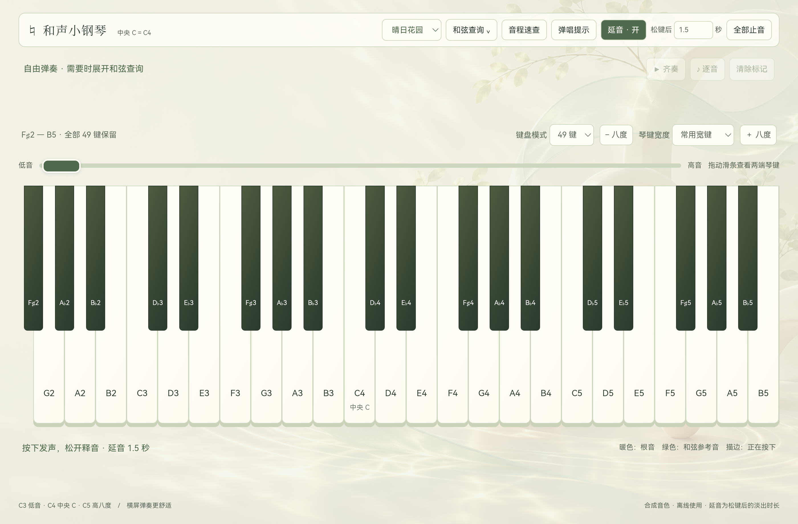

# 和声小钢琴 · 安卓离线版

**1.2.0** · Android 8.0+ · 全屏钢琴 · 无需联网使用

[国内加速下载](https://ghfast.top/https://github.com/Lucifer-cgl/musictheory/releases/download/v1.2.0/HarmonyPiano-1.2.0-release.apk) · [GitHub下载](https://github.com/Lucifer-cgl/musictheory/releases/download/v1.2.0/HarmonyPiano-1.2.0-release.apk) · [发布说明](https://github.com/Lucifer-cgl/musictheory/releases/tag/v1.2.0)



## 功能

- 默认49键，可选88键（A0–C8），默认视窗到B5，滑条访问完整音域，键宽不被挤小。
- 多指演奏、滑动换音、49键模式整体移八度；88键模式移动可视位置。
- 21类和弦查询：中文、符号、带根音符号，支持组成音标记和齐奏/逐音试听。
- 音程速查：0–12半音对应的常见音程；弹唱提示：双手分工、柱式/分解、延音。
- 延音开关，可设置松键后0.2–10秒逐渐淡出，全部止音及后台清理。
- 三套离线插画主题，背景淡化，琴键与按钮同步换色。
- 中央C明确标作C4（MIDI60），A4=440Hz。

## 源码构建

本工程自包含，不依赖网站目录。需Java、Node.js及Android SDK。默认使用SDK的build-tools 36.0.0和platforms/android-35。

```powershell
./build.ps1 -SdkRoot 'E:/android-sdk' -OutputDirectory '../release'
```

输出 `HarmonyPiano-1.2.0-release.apk` 与SHA-256文件。无需Gradle，也无需安装Node依赖。

首次构建会在 `.signing/` 本地创建签名；**私钥没有上传到GitHub**。自行构建的签名与Release附件不同时，不能直接覆盖安装官方附件；开发时请使用自己的签名并持续保留它。Release明确关闭 `android:debuggable`。

## 目录

| 路径 | 内容 |
| --- | --- |
| `src/cn/harmonygarden/piano/MainActivity.java` | 原生入口、离线资源、全屏与后台止音 |
| `assets/piano.js` | 49/88键、视窗、查询、演奏 |
| `assets/piano.css`、`assets/themes.css` | 布局和三套主题 |
| `assets/chord-data.js` | 完整21类和弦定义 |
| `assets/piano-release.js`、`assets/piano-guide.js` | 尾音处理、音程与弹唱说明 |
| `assets/art/` | 离线主题背景 |
| `res/`、`AndroidManifest.xml` | 图标与原生配置 |
| `scripts/sync-assets.cjs` | 离线素材完整性检查 |
| `build.ps1` | 编译、Dex、对齐及签名 |

## 验证

浏览器测试为可选开发依赖：`npm install`、`npx playwright install chromium`，另启 `npm run preview`，再运行 `npm test`。覆盖49/88音集、查询、四指、延音、滑条、视窗边界和布局。

已在华为TGR_W10平板安装启动并核对实际界面。合成音色与真实钢琴不同，延音按松键后的淡出时长模拟。

`build/`、`node_modules/`、`.signing/`、APK及本机配置由Git忽略，保留在本地，不随源码上传。
