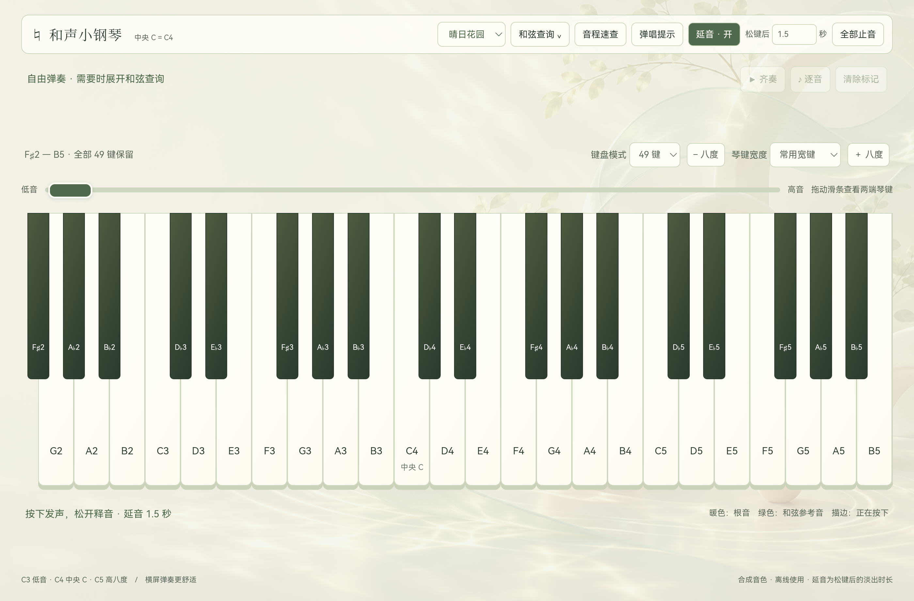

# 和声花园 · Music Theory

可以弹、可以听、可以查的乐理学习工具：一个网页实验室，一款离线安卓小钢琴。

## 下载安卓小钢琴

当前版本 **1.2.0**，支持 **Android 8.0 及以上**。

- **[国内加速下载（GHFast）](https://ghfast.top/https://github.com/Lucifer-cgl/musictheory/releases/download/v1.2.0/HarmonyPiano-1.2.0-release.apk)**
- [备用加速下载（GH-Proxy）](https://gh-proxy.com/https://github.com/Lucifer-cgl/musictheory/releases/download/v1.2.0/HarmonyPiano-1.2.0-release.apk)
- [GitHub 原始下载](https://github.com/Lucifer-cgl/musictheory/releases/download/v1.2.0/HarmonyPiano-1.2.0-release.apk)
- [全部版本与发布说明](https://github.com/Lucifer-cgl/musictheory/releases)

两个加速入口已于2026年11月14日完成整包下载与SHA-256一致性验证。加速入口是第三方 GitHub Release 下载代理，并非独立维护的国内安装包仓库；不同网络下可用性可能不同。下载后可用 Release 附带的 SHA-256 文件核对安装包。

```text
ee260ec88734c211fb7a0373caa3767baa17279b427f691b6f8a7cab8876465b  HarmonyPiano-1.2.0-release.apk
```

## 两个项目

| 项目 | 内容 | 运行方式 |
| --- | --- | --- |
| [harmony-lab](./harmony-lab/) | 音程图解、21类和弦手册、模拟钢琴、原创弹唱演示 | 浏览器打开本地静态服务 |
| [HarmonyPiano-Android](./HarmonyPiano-Android/) | 全屏离线钢琴、49/88键模式、和弦查询、音程速查、延音、三套主题 | 安装APK，或从源码构建 |

安卓默认 **49键**；可切换完整 **88键（A0–C8）**。常用视窗默认到 **B5**，通过上方滑条查看其他琴键，保持舒适的键宽。和弦参考、齐奏/逐音试听、多指演奏、可调延音均保留。

网页保持49键，浮动钢琴与全屏钢琴均支持同样的宽键滑条；另有从半音数量理解音程、查看和弦构成及跟随原创示范学习的内容。



## 目录

```text
musictheory/
├─ README.md
├─ .gitignore
├─ .gitattributes
├─ harmony-lab/             # 网页源码与必要运行素材
└─ HarmonyPiano-Android/    # 安卓源码、离线素材与构建脚本
```

APK和校验文件作为 **Release附件** 发布，不放入Git源码。依赖、Android编译产物、测试截图、临时导出、签名私钥和本机配置均由 `.gitignore` 排除。网页免构建，`harmony-lab/dist/` 本身就是HTML/CSS/JavaScript源码，必须保留。

## 本地启动网页

```powershell
git clone https://github.com/Lucifer-cgl/musictheory.git
cd musictheory/harmony-lab
python -m http.server 4173 --directory dist
```

浏览器打开 `http://localhost:4173`。无需框架构建或付费接口。

## 从源码构建安卓

详见 [安卓工程说明](./HarmonyPiano-Android/README.md)。需要Java、Node.js和Android SDK；构建脚本不依赖Gradle。首次构建会在本地创建签名文件，签名不随源码发布。

## 音乐内容

原创教学曲《把脚步还给自己》包含前奏、间奏、尾奏及对齐的简谱与歌词。演示女声通过 [绮萱·DiffSinger](https://github.com/yqzhishen/qixuan-diffsinger) 与 OpenUtau 本地合成，项目中标明了合成来源。
