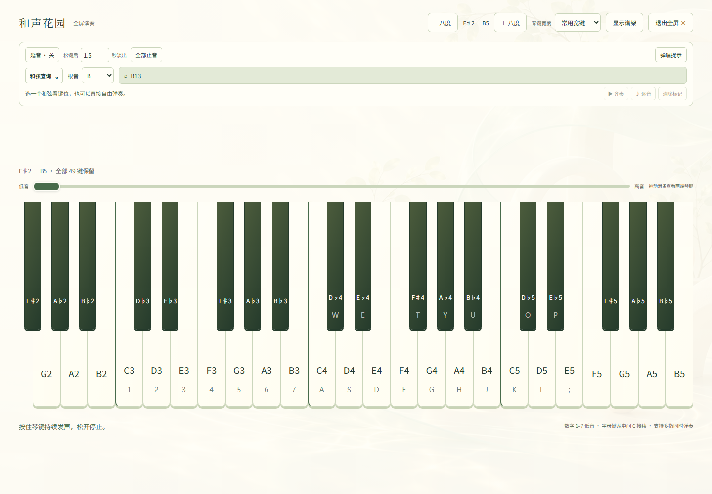

# 和声花园 · 网页乐理实验室

从琴键的半音距离出发，理解音程、音阶、和弦与弹唱伴奏。

## 功能

- 按标签学习音程、音阶、和弦构成、功能与进行、听见与应用、弹唱演示。
- 0–12半音图示，解释度数与大小/纯/增减性质。
- 21类和弦，任意根音查看组成音、音程名、半音数及琴键位置。
- 随身小钢琴与全屏模式，49键完整保留；默认视窗到B5，上方滑条移动视窗，琴键加宽。
- 查询和弦后保留参考标记，同时自由弹奏；支持电脑键盘、多指触屏、齐奏及逐音试听。
- 延音开关、0.2–10秒松键淡出、全部止音，可选本地谱图。
- 晴日花园、莫奈池塘、雾中微光三套全局主题。
- 原创40小节示范《把脚步还给自己》：简谱、和弦与琴键沿同一时间线推进，包含AI合成女声。



## 运行

在本目录运行：

```powershell
python -m http.server 4173 --directory dist
```

打开 `http://localhost:4173`。`dist/` 是实际网页源码与素材，免构建，不是应忽略的编译目录。可将此目录交给任意静态服务器部署。

## 开发与验证

浏览器测试使用Playwright：

```powershell
npm ci
npx playwright install chromium
npm test
```

测试前保持4173端口的静态服务运行。若浏览器已安装到自定义位置，可设置 `PLAYWRIGHT_CHROMIUM_EXECUTABLE`。`qa-output/` 是测试生成截图，不上传。

主要文件：`dist/index.html` 为入口，`workspace.js` 为标签与输入控制，`continuous-piano.js` 为连续琴键，`fullscreen-piano.js` 为全屏/谱架，`piano-chords.js` 为查询，`piano-slider.js` 为宽键视窗，`piano-sustain.js` 与 `piano-release.js` 为延音，`songbook.js` 与 `local-vocal.js` 为弹唱演示。

## 素材与导出

页面实际使用的插画、音频、谱图和歌曲数据随源码保留。测试结果、额外导出目录、依赖、私有托管配置以及旧的安卓拷贝不上传。独立安卓工程位于仓库同级的 [HarmonyPiano-Android](../HarmonyPiano-Android/)。

女声来源与下载入口已在演示页标注：[绮萱·DiffSinger](https://github.com/yqzhishen/qixuan-diffsinger)，使用OpenUtau本地渲染。
